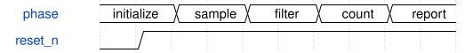

# EncoderDebug 模块规范

> RTL: `src/EncoderDebug.v`

## 1. 模块目的

未提供模块目的。

## 2. 参数

| 参数 | 默认值 | 说明 |
| --- | --- | --- |
| — | — | 本模块没有可配置参数。 |

## 3. 时钟与复位

- 时钟：`{"name": "i_clk", "frequency_mhz": 50, "edge": "posedge"}`
- 复位：`{"name": "i_rstn", "active": "low", "synchronous": false, "description": "Top synchronizes release for child modules"}`

## 4. 接口信号规范

| 信号 | 方向 | 位宽 | 时钟域 | 语义角色 | 描述 |
| --- | --- | --- | --- | --- | --- |
| `i_clk` | input | 1 | 未声明 | clock | 50MHz clock |
| `i_rstn` | input | 1 | 未声明 | reset | Active-low reset |
| `i_encoder_a` | input | 5 | 未声明 | data | Five A pins in board order |
| `i_encoder_b` | input | 5 | 未声明 | data | Five B pins in board order |
| `o_uart_tx` | output | 1 | 未声明 | data | U15 to debugger UART |

## 5. 周期行为与延迟

- Synchronize reset release; instantiate five independent channels.
- Every 100ms send five 34-byte ASCII lines; every line has one coherent snapshot.
- Format: E1 A3 F3 Q0000 P0000 N0000 X0000 CR LF. Input sampling continues during output.

## 6. WaveDrom 时序图

### EncoderDebug conceptual operation

Conceptual phases; not a measured trace.

- WaveJSON：[EncoderDebug_operation.json5](waveforms/EncoderDebug_operation.json5)

## 7. 边界、反压与错误

- Initial stable phase must not generate a rotation.
- Reset aborts UART and clears all counters.
- Double-bit transition is rejected from position, not reconstructed.

## 8. CDC 与综合约束

- C_FILTER_CYCLES >= 2 and <=65535; C_BAUD_CYCLES >=2 and <=65535.
- C_REPORT_CYCLES must exceed full five-line UART transmission for every interval to be serviced.
- AB voltage must be compatible with 3.3V IO. Mechanical CW polarity is not yet calibrated.

## 9. 验证与验收

- xsim positive, negative, short glitch, backtracking bounce, invalid transition, five-channel mapping, exact ASCII and reset during UART.
- Gowin synthesis and timing; hardware rotate test still required.

## 10. 可追溯性

- 规格模块：`EncoderDebug`
- RTL 路径：`src/EncoderDebug.v`
- 交付要求：本文档、WaveJSON 和 SVG 必须与同一版本规格一同发布。
