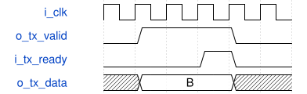

# HardwareButtonReport Module Specification

> RTL: `src/HardwareButtonReport.v`

## 1. 模块目的

未提供模块目的。

## 2. 参数

| 参数 | 默认值 | 说明 |
| --- | --- | --- |
| — | — | 本模块没有可配置参数。 |

## 3. 时钟与复位

- 时钟：`{"name": "i_clk", "frequency_mhz": 50, "edge": "posedge"}`
- 复位：`{"name": "i_rstn", "active": "low", "synchronous": false, "description": "Top synchronizes release for child modules"}`

## 4. 接口信号规范

| 信号 | 方向 | 位宽 | 时钟域 | 语义角色 | 描述 |
| --- | --- | --- | --- | --- | --- |
| `i_clk` | input | 1 | 未声明 | clock | i clk |
| `i_rstn` | input | 1 | 未声明 | reset | i rstn |
| `i_raw` | input | 6 | 未声明 | data | i raw |
| `i_pressed` | input | 6 | 未声明 | data | i pressed |
| `i_presses` | input | 96 | 未声明 | data | i presses |
| `i_releases` | input | 96 | 未声明 | data | i releases |
| `i_edges` | input | 96 | 未声明 | data | i edges |
| `i_tx_ready` | input | 1 | 未声明 | data | i tx ready |
| `o_tx_valid` | output | 1 | 未声明 | data | o tx valid |
| `o_tx_data` | output | 8 | 未声明 | data | o tx data |

## 5. 周期行为与延迟

- Capture all input fields on the same clock. Emit B1 ASCII frame with exactly 87 bytes and CRC8 polynomial 07 over 82 body bytes. Sequence and counters wrap at 65536; SW1 is bit 0 and highest packed 16-bit counter.
- A TelemetryByte register holds each byte until ready; ST_ACCEPT observes busy assertion before ST_WAIT accepts its deassertion. ST_ADVANCE alone advances the snapshot. Periodic ticks while busy are skipped; sequence increments only on capture. Sampling continues during backpressure.

## 6. WaveDrom 时序图

### Held byte under backpressure

Conceptual ready/valid handshake: data remains stable until ready.

- WaveJSON：[HardwareButtonReport_backpressure.json5](waveforms/HardwareButtonReport_backpressure.json5)

## 7. 边界、反压与错误

- Reset clears all counters; held-at-reset input counts once.
- Simultaneous keys do not share filter state. Counters and sequence wrap unsigned.
- Raw telemetry is a sampled snapshot, not a lossless waveform.

## 8. CDC 与综合约束

- 50 MHz rising-edge clock. Asynchronous active-low reset with synchronized release owned by HardwareLab.
- C_STABLE_CYCLES and C_REPORT_CYCLES must be positive; reset aborts a frame and host resynchronizes at LF.
- SW1..SW6 pins AA19, AB18, Y18, N15, U17, P15, 3.3 V active-high with weak DOWN. TP2 SCL remains AA18.

## 9. 验证与验收

- xsim: bounce both edges, channel mapping, simultaneous press/release, long hold, modulo wrap, reset held.
- Actual UART bits decoded independently in Python and Rust; CRC, fields, sequence, snapshot isolation.
- Gowin routing/timing and SRAM download; physical per-switch test is separate evidence.

## 10. 可追溯性

- 规格模块：`HardwareButtonReport`
- RTL 路径：`src/HardwareButtonReport.v`
- 交付要求：本文档、WaveJSON 和 SVG 必须与同一版本规格一同发布。
