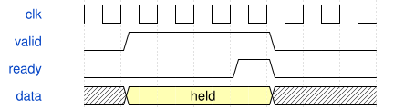

# HardwareKeyboardTelemetry 模块规范

> RTL: `src/HardwareKeyboardTelemetry.v`

## 1. 模块目的

未提供模块目的。

## 2. 参数

| 参数 | 默认值 | 说明 |
| --- | --- | --- |
| — | — | 本模块没有可配置参数。 |

## 3. 时钟与复位

- 时钟：`{"name": "i_clk", "frequency_mhz": 50, "edge": "posedge"}`
- 复位：`{"name": "i_rstn", "active": "low", "synchronous": false, "description": "Top asynchronous assertion and synchronized release"}`

## 4. 接口信号规范

| 信号 | 方向 | 位宽 | 时钟域 | 语义角色 | 描述 |
| --- | --- | --- | --- | --- | --- |
| `i_clk` | input | 1 | 未声明 | clock | i_clk; requirements.md defines transport/control semantics |
| `i_rstn` | input | 1 | 未声明 | reset | i_rstn; requirements.md defines transport/control semantics |
| `i_key` | input | 5 | 未声明 | data | i_key; requirements.md defines transport/control semantics |
| `i_raw` | input | 12 | 未声明 | data | i_raw; requirements.md defines transport/control semantics |
| `i_valid` | input | 1 | 未声明 | data | i_valid; requirements.md defines transport/control semantics |
| `o_ready` | output | 1 | 未声明 | data | o_ready; requirements.md defines transport/control semantics |
| `i_ack` | input | 1 | 未声明 | data | i_ack; requirements.md defines transport/control semantics |
| `i_ack_seq` | input | 8 | 未声明 | data | i_ack_seq; requirements.md defines transport/control semantics |
| `i_ack_result` | input | 8 | 未声明 | data | i_ack_result; requirements.md defines transport/control semantics |
| `i_configured` | input | 1 | 未声明 | data | i_configured; requirements.md defines transport/control semantics |
| `i_generation` | input | 8 | 未声明 | data | i_generation; requirements.md defines transport/control semantics |
| `i_mode` | input | 4 | 未声明 | data | i_mode; requirements.md defines transport/control semantics |
| `i_direction` | input | 1 | 未声明 | data | i_direction; requirements.md defines transport/control semantics |
| `i_pressed` | input | 32 | 未声明 | data | i_pressed; requirements.md defines transport/control semantics |
| `i_game_status` | input | 128 | 未声明 | data | i_game_status; requirements.md defines transport/control semantics |
| `i_tx_ready` | input | 1 | 未声明 | data | i_tx_ready; requirements.md defines transport/control semantics |
| `o_tx_valid` | output | 1 | 未声明 | data | o_tx_valid; requirements.md defines transport/control semantics |
| `o_tx_data` | output | 8 | 未声明 | data | o_tx_data; requirements.md defines transport/control semantics |
| `o_priority` | output | 1 | 未声明 | data | o_priority; requirements.md defines transport/control semantics |

## 5. 周期行为与延迟

- ACK and periodic status/game CRC generation retained. Emit one stable byte until tx_ready, no local bit serializer.

## 6. WaveDrom 时序图

### Held byte transfer

Conceptual ready/valid sequence; not measured timing.

- WaveJSON：[HardwareKeyboardTelemetry_backpressure.json5](waveforms/HardwareKeyboardTelemetry_backpressure.json5)

## 7. 边界、反压与错误

- Reset aborts partially sent line; host parser must resynchronize.
- Pending data remains stable under backpressure; physical sampling continues.

## 8. CDC 与综合约束

- Verilog2001; 50MHz; original electrical interfaces unchanged.

## 9. 验证与验收

- Wire-level ADC/UART,32-key atomic calibration,ACK retry,reactive effects and piano game integration.
- Dual-pad guitar mixed with encoder and joystick frames; bounded-priority saturated arbiter.

## 10. 可追溯性

- 规格模块：`HardwareKeyboardTelemetry`
- RTL 路径：`src/HardwareKeyboardTelemetry.v`
- 交付要求：本文档、WaveJSON 和 SVG 必须与同一版本规格一同发布。
