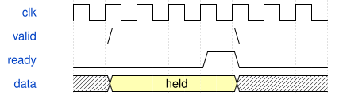

# HardwareLab 模块规范

> RTL: `src/HardwareLab.v`

## 1. 模块目的

未提供模块目的。

## 2. 参数

| 参数 | 默认值 | 说明 |
| --- | --- | --- |
| — | — | 本模块没有可配置参数。 |

## 3. 时钟与复位

- 时钟：`{"name": "i_clk", "frequency_mhz": 50, "edge": "posedge"}`
- 复位：`{"name": "i_rstn", "active": "low", "synchronous": false, "description": "Top asynchronous assertion and synchronized release"}`

## 4. 接口信号规范

| 信号 | 方向 | 位宽 | 时钟域 | 语义角色 | 描述 |
| --- | --- | --- | --- | --- | --- |
| `i_clk` | input | 1 | 未声明 | clock | i_clk; requirements.md defines transport/control semantics |
| `i_rstn` | input | 1 | 未声明 | reset | i_rstn; requirements.md defines transport/control semantics |
| `i_adc_dout` | input | 1 | 未声明 | data | i_adc_dout; requirements.md defines transport/control semantics |
| `i_uart_rx` | input | 1 | 未声明 | data | i_uart_rx; requirements.md defines transport/control semantics |
| `i_encoder_a` | input | 5 | 未声明 | data | i_encoder_a; requirements.md defines transport/control semantics |
| `i_encoder_b` | input | 5 | 未声明 | data | i_encoder_b; requirements.md defines transport/control semantics |
| `i_joystick` | input | 5 | 未声明 | data | i_joystick; requirements.md defines transport/control semantics |
| `i_irq` | input | 2 | 未声明 | data | i_irq; requirements.md defines transport/control semantics |
| `io_scl` | inout | 2 | 未声明 | data | io_scl; requirements.md defines transport/control semantics |
| `io_sda` | inout | 2 | 未声明 | data | io_sda; requirements.md defines transport/control semantics |
| `o_mux_sel` | output | 3 | 未声明 | data | o_mux_sel; requirements.md defines transport/control semantics |
| `o_mux_en` | output | 1 | 未声明 | data | o_mux_en; requirements.md defines transport/control semantics |
| `o_adc_cs_n` | output | 1 | 未声明 | data | o_adc_cs_n; requirements.md defines transport/control semantics |
| `o_adc_sclk` | output | 1 | 未声明 | data | o_adc_sclk; requirements.md defines transport/control semantics |
| `o_adc_din` | output | 1 | 未声明 | data | o_adc_din; requirements.md defines transport/control semantics |
| `o_rgb` | output | 1 | 未声明 | data | o_rgb; requirements.md defines transport/control semantics |
| `o_uart_tx` | output | 1 | 未声明 | data | o_uart_tx; requirements.md defines transport/control semantics |

## 5. 周期行为与延迟

- Unified50MHz/reset and34 unique pins. Parallel keyboard/encoder/joystick/touchpad/guitar modules share one UART.
- Keyboard100ms snapshots, encoders100ms,joystick50ms,touch telemetry50ms alternating boards,identity250ms.

## 6. WaveDrom 时序图

### Held byte transfer

Conceptual ready/valid sequence; not measured timing.

- WaveJSON：[HardwareLab_backpressure.json5](waveforms/HardwareLab_backpressure.json5)

## 7. 边界、反压与错误

- Reset aborts partially sent line; host parser must resynchronize.
- Pending data remains stable under backpressure; physical sampling continues.

## 8. CDC 与综合约束

- Verilog2001; 50MHz; original electrical interfaces unchanged.

## 9. 验证与验收

- Wire-level ADC/UART,32-key atomic calibration,ACK retry,reactive effects and piano game integration.
- Dual-pad guitar mixed with encoder and joystick frames; bounded-priority saturated arbiter.

## 10. 可追溯性

- 规格模块：`HardwareLab`
- RTL 路径：`src/HardwareLab.v`
- 交付要求：本文档、WaveJSON 和 SVG 必须与同一版本规格一同发布。

## Six-switch integration (2026-11-02)

Additional input `i_buttons[5:0]`, SW1 bit0. C_BUTTON_FILTER=250000, C_BUTTON_REPORT=5000000. Six ordinary/priority-capable telemetry lanes; lane5 is ordinary B1, shares reset and UART. Independent input counters run continuously. See HardwareButtons_spec.md and HardwareButtonReport_spec.md. H1 capabilities=00FF/build=0101.
