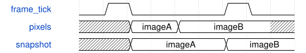

# GameDisplay 模块规范

> RTL: `src/GameDisplay.v`

## 1. 模块目的

未提供模块目的。

## 2. 参数

| 参数 | 默认值 | 说明 |
| --- | --- | --- |
| — | — | 本模块没有可配置参数。 |

## 3. 时钟与复位

- 时钟：`{"name": "i_clk", "frequency_mhz": 50, "edge": "posedge"}`
- 复位：`{"name": "i_rstn", "active": "low", "synchronous": false, "description": "Top provides synchronized release"}`

## 4. 接口信号规范

| 信号 | 方向 | 位宽 | 时钟域 | 语义角色 | 描述 |
| --- | --- | --- | --- | --- | --- |
| `i_clk` | input | 1 | 未声明 | clock | 50MHz clock |
| `i_rstn` | input | 1 | 未声明 | reset | Active-low reset |
| `i_enable` | input | 1 | 未声明 | data | Game owns LEDs |
| `i_frame_tick` | input | 1 | 未声明 | data | Capture whole frame |
| `i_pixels` | input | 64 | 未声明 | data | 32palette pixels |
| `i_pixel` | input | 5 | 未声明 | data | LED index |
| `o_active` | output | 1 | 未声明 | data | Frame-frozen source selection |
| `o_grb` | output | 24 | 未声明 | data | Palette GRB data |

## 5. 周期行为与延迟

- Capture enable and all64pixel bits on frame tick; hold until next tick.
- Palette uses green/red/cyan at32/255 channel level. Top source mux uses captured ownership.

## 6. WaveDrom 时序图

### GameDisplay

Conceptual phases; frame tick is50Hz in hardware.

- WaveJSON：[GameDisplay_operation.json5](waveforms/GameDisplay_operation.json5)

## 7. 边界、反压与错误

- Reset clears all game state and pixels.
- Source pixels must be synchronous; LED transmitter loads after snapshot cycle.

## 8. CDC 与综合约束

- Source pixels must be synchronous; LED transmitter loads after snapshot cycle.

## 9. 验证与验收

- All four palette values, enable/image changes between ticks do not tear frame, reset clears source.

## 10. 可追溯性

- 规格模块：`GameDisplay`
- RTL 路径：`src/GameDisplay.v`
- 交付要求：本文档、WaveJSON 和 SVG 必须与同一版本规格一同发布。
