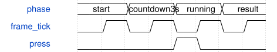

# GameEngine 模块规范

> RTL: `src/GameEngine.v`

## 1. 模块目的

未提供模块目的。

## 2. 参数

| 参数 | 默认值 | 说明 |
| --- | --- | --- |
| — | — | 本模块没有可配置参数。 |

## 3. 时钟与复位

- 时钟：`{"name": "i_clk", "frequency_mhz": 50, "edge": "posedge"}`
- 复位：`{"name": "i_rstn", "active": "low", "synchronous": false, "description": "Top provides synchronized release"}`

## 4. 接口信号规范

| 信号 | 方向 | 位宽 | 时钟域 | 语义角色 | 描述 |
| --- | --- | --- | --- | --- | --- |
| `i_clk` | input | 1 | 未声明 | clock | 50MHz clock |
| `i_rstn` | input | 1 | 未声明 | reset | Active-low reset |
| `i_start` | input | 1 | 未声明 | data | Start selected game |
| `i_stop` | input | 1 | 未声明 | data | Stop, priority over start |
| `i_game` | input | 2 | 未声明 | data | 1snake2mole3piano |
| `i_frame_tick` | input | 1 | 未声明 | data | 50Hz enable pulse |
| `i_press` | input | 32 | 未声明 | data | Qualified rising press pulses |
| `i_pressed` | input | 32 | 未声明 | data | Held key bitmap |
| `o_pixels` | output | 64 | 未声明 | data | Key0bits1:0; palette0black1green2red3cyan |
| `o_status` | output | 128 | 未声明 | data | game,phase,seconds,reason,score16,misses,epoch,pixels64 |

## 5. 周期行为与延迟

- Three-second countdown; game state advances entirely on FPGA clock and50Hz frame enables.
- Snake uses28-cell arena excluding K23/K30/K31/K32 controls; green body, red apple, collision and full-board win detection.
- Only one direction queued per movement, no reversal; exactly coincident direction input queues for next move.
- Mole lasts3000 frame ticks: green10/80ticks, red30/45ticks, cyan20/60ticks; spawn30ticks, held cells excluded.
- Mole simultaneous scores/expiries use balanced reduction trees; hit wins expiry, final deadline suppresses hits.
- Piano bottom keys only; successful press shifts notes and adds1; wrong/multiple/expired press ends. Deadline90ticks down to25.
- Failure flashes red at2.5Hz for2seconds; success/timeout settlement green. Score retained until next game.
- LFSR free-runs; free-cell placement probes one cell per clock to avoid long combinational search.

## 6. WaveDrom 时序图

### GameEngine

Conceptual phases; frame tick is50Hz in hardware.

- WaveJSON：[GameEngine_operation.json5](waveforms/GameEngine_operation.json5)

## 7. 边界、反压与错误

- Reset clears all game state and pixels.
- i_frame_tick must be50Hz for wall-clock durations.
- Start requires calibrated configuration, enforced by KeyController.
- Palette and4x8 physical mapping fixed; no internet, CPU or App timing dependency.

## 8. CDC 与综合约束

- i_frame_tick must be50Hz for wall-clock durations.
- Start requires calibrated configuration, enforced by KeyController.
- Palette and4x8 physical mapping fixed; no internet, CPU or App timing dependency.

## 9. 验证与验收

- tb_game_engine: countdown, growth, queued turns, reverse rejection, wall/self/tail/full-board, color scores, concurrent hits, expiry, held exclusion, exact60seconds, piano shift/errors/timeout/last-tick hit, stop/reset.
- tb_keyboard_games: actualUART game command/CRC/epoch plus ADC-qualified piano input.

## 10. 可追溯性

- 规格模块：`GameEngine`
- RTL 路径：`src/GameEngine.v`
- 交付要求：本文档、WaveJSON 和 SVG 必须与同一版本规格一同发布。
