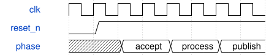

# KeyboardGames 模块规范

> RTL: `src/KeyboardGames.v`

## 1. 模块目的

未提供模块目的。

## 2. 参数

| 参数 | 默认值 | 说明 |
| --- | --- | --- |
| — | — | 本模块没有可配置参数。 |

## 3. 时钟与复位

- 时钟：`{"name": "i_clk", "frequency_mhz": 50, "edge": "posedge"}`
- 复位：`{"name": "i_rstn", "active": "low", "synchronous": false, "description": "Async assertion; synchronous release provided by top"}`

## 4. 接口信号规范

| 信号 | 方向 | 位宽 | 时钟域 | 语义角色 | 描述 |
| --- | --- | --- | --- | --- | --- |
| `i_clk` | input | 1 | 未声明 | clock | 50 MHz rising-edge clock |
| `i_rstn` | input | 1 | 未声明 | reset | Active-low reset; top synchronizes release |
| `i_adc_dout` | input | 1 | 未声明 | data | adc dout |
| `i_uart_rx` | input | 1 | 未声明 | data | uart rx |
| `o_mux_sel` | output | 3 | 未声明 | data | mux sel |
| `o_mux_en` | output | 1 | 未声明 | data | mux en |
| `o_adc_cs_n` | output | 1 | 未声明 | data | adc cs n |
| `o_adc_sclk` | output | 1 | 未声明 | data | adc sclk |
| `o_adc_din` | output | 1 | 未声明 | data | adc din |
| `o_uart_tx` | output | 1 | 未声明 | data | uart tx |
| `o_rgb` | output | 1 | 未声明 | data | rgb |

## 5. 周期行为与延迟

- Top synchronizes reset release through two flops; acquisition, command RX, controller, telemetry and RGB run concurrently.
- Calibration/thresholds arrive byUART; FPGA owns pressed state and all effect timing.
- GameEngine owns all game rules and timers; GameDisplay snapshots its palette image.
- App disconnect never resets games; telemetry shares UART at record boundaries.

## 6. WaveDrom 时序图

### KeyboardReactive operation

Conceptual phases; exact cycle contract and verification are specified above.

- WaveJSON：[KeyboardGames_operation.json5](waveforms/KeyboardGames_operation.json5)

## 7. 边界、反压与错误

- Reset aborts active operation; valid/configured state cleared.
- Tang Mega NEO60K Dock31004, GW5AT-60B,50MHz. RXV14 TXU15 RGBR19; original keyboard pin mapping retained.
- SRAM-only deployment; no external Flash or debugger configuration changes.

## 8. CDC 与综合约束

- Tang Mega NEO60K Dock31004, GW5AT-60B,50MHz. RXV14 TXU15 RGBR19; original keyboard pin mapping retained.
- SRAM-only deployment; no external Flash or debugger configuration changes.

## 9. 验证与验收

- Integrated ADC+UART test, Gowin50MHz timing, SRAM download and real serial ACK evidence are separate gates.

## 10. 可追溯性

- 规格模块：`KeyboardGames`
- RTL 路径：`src/KeyboardGames.v`
- 交付要求：本文档、WaveJSON 和 SVG 必须与同一版本规格一同发布。
