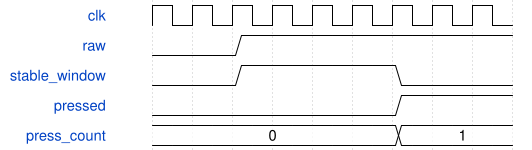

# TactileInput Module Specification

> RTL: `src/TactileInput.v`

## 1. 模块目的

未提供模块目的。

## 2. 参数

| 参数 | 默认值 | 说明 |
| --- | --- | --- |
| — | — | 本模块没有可配置参数。 |

## 3. 时钟与复位

- 时钟：`{"name": "i_clk", "frequency_mhz": 50, "edge": "posedge"}`
- 复位：`{"name": "i_rstn", "active": "low", "synchronous": false, "description": "Top synchronizes release for child modules"}`

## 4. 接口信号规范

| 信号 | 方向 | 位宽 | 时钟域 | 语义角色 | 描述 |
| --- | --- | --- | --- | --- | --- |
| `i_clk` | input | 1 | 未声明 | clock | clock |
| `i_rstn` | input | 1 | 未声明 | reset | reset |
| `i_switch` | input | 1 | 未声明 | data | active-high physical switch |
| `o_raw` | output | 1 | 未声明 | data | two-stage synchronized level |
| `o_pressed` | output | 1 | 未声明 | data | debounced active-high level |
| `o_presses` | output | 16 | 未声明 | data | wrapping press count |
| `o_releases` | output | 16 | 未声明 | data | wrapping release count |
| `o_edges` | output | 16 | 未声明 | data | wrapping raw edge count |

## 5. 周期行为与延迟

- Two-stage synchronization before debounce; requires C_STABLE_CYCLES consecutive different samples to change stable state. A return to current level cancels candidate.
- Press/release/raw-edge counters wrap at 65536. Held input is not repeated; a switch held through reset is counted once after the stable window.

## 6. WaveDrom 时序图

### TactileInput conceptual timing

Conceptual phases, not a measured trace; synchronization precedes the five-millisecond stability window.

- WaveJSON：[TactileInput_stable-window.json5](waveforms/TactileInput_stable-window.json5)

## 7. 边界、反压与错误

- Reset clears all counters; held-at-reset input counts once.
- Simultaneous keys do not share filter state. Counters and sequence wrap unsigned.
- Raw telemetry is a sampled snapshot, not a lossless waveform.

## 8. CDC 与综合约束

- 50 MHz clock, 3.3 V switch inputs; C_STABLE_CYCLES >= 1, C_REPORT_CYCLES >= 1, C_BAUD_CYCLES >= 2.
- Production debounce 250000 cycles; report 1000000 cycles; UART divisor 434. Logical press counters survive any missed display refresh.

## 9. 验证与验收

- xsim: bounce both edges, channel mapping, simultaneous press/release, long hold, modulo wrap, reset held.
- Actual UART bits decoded independently in Python and Rust; CRC, fields, sequence, snapshot isolation.
- Gowin routing/timing and SRAM download; physical per-switch test is separate evidence.

## 10. 可追溯性

- 规格模块：`TactileInput`
- RTL 路径：`src/TactileInput.v`
- 交付要求：本文档、WaveJSON 和 SVG 必须与同一版本规格一同发布。
