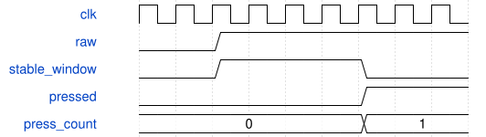

# TactileReport Module Specification

> RTL: `src/TactileReport.v`

## 1. 模块目的

未提供模块目的。

## 2. 参数

| 参数 | 默认值 | 说明 |
| --- | --- | --- |
| — | — | 本模块没有可配置参数。 |

## 3. 时钟与复位

- 时钟：`{"name": "i_clk", "frequency_mhz": 50, "edge": "posedge"}`
- 复位：`{"name": "i_rstn", "active": "low", "synchronous": false, "description": "Top synchronizes release for child modules"}`

## 4. 接口信号规范

| 信号 | 方向 | 位宽 | 时钟域 | 语义角色 | 描述 |
| --- | --- | --- | --- | --- | --- |
| `i_clk` | input | 1 | 未声明 | clock | clock |
| `i_rstn` | input | 1 | 未声明 | reset | reset |
| `i_raw` | input | 6 | 未声明 | data | raw mask bit zero SW1 |
| `i_pressed` | input | 6 | 未声明 | data | debounced mask |
| `i_presses` | input | 96 | 未声明 | data | six press counters SW1 at high bits |
| `i_releases` | input | 96 | 未声明 | data | six release counters SW1 at high bits |
| `i_edges` | input | 96 | 未声明 | data | six edge counters SW1 at high bits |
| `o_tx` | output | 1 | 未声明 | data | 115200 8N1 ASCII B1 frames |

## 5. 周期行为与延迟

- Every C_REPORT_CYCLES, if idle, atomically snapshot sequence, raw/filtered masks, presses, releases, and raw edges. Busy ticks are skipped, not queued.
- Emit exactly 87 bytes, B1 + 80 hex payload characters + * + CRC8 + CR LF. CRC polynomial 0x07, zero seed, covers the 82 ASCII body bytes.
- Each byte uses start/accept/wait sequencing with the unchanged EncoderUartTx. Snapshot source changes cannot alter an in-progress frame.

## 6. WaveDrom 时序图

### TactileReport conceptual timing

Conceptual phases, not a measured trace; synchronization precedes the five-millisecond stability window.

- WaveJSON：[TactileReport_stable-window.json5](waveforms/TactileReport_stable-window.json5)

## 7. 边界、反压与错误

- Reset clears all counters; held-at-reset input counts once.
- Simultaneous keys do not share filter state. Counters and sequence wrap unsigned.
- Raw telemetry is a sampled snapshot, not a lossless waveform.

## 8. CDC 与综合约束

- 50 MHz clock, 3.3 V switch inputs; C_STABLE_CYCLES >= 1, C_REPORT_CYCLES >= 1, C_BAUD_CYCLES >= 2.
- Production debounce 250000 cycles; report 1000000 cycles; UART divisor 434. Logical press counters survive any missed display refresh.

## 9. 验证与验收

- xsim: bounce both edges, channel mapping, simultaneous press/release, long hold, modulo wrap, reset held.
- Actual UART bits decoded independently in Python and Rust; CRC, fields, sequence, snapshot isolation.
- Gowin routing/timing and SRAM download; physical per-switch test is separate evidence.

## 10. 可追溯性

- 规格模块：`TactileReport`
- RTL 路径：`src/TactileReport.v`
- 交付要求：本文档、WaveJSON 和 SVG 必须与同一版本规格一同发布。
