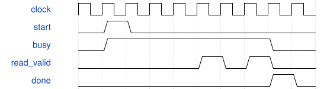

# TouchpadDebug 模块规范

> RTL: `src/TouchpadDebug.v`

## 1. 模块目的

未提供模块目的。

## 2. 参数

| 参数 | 默认值 | 说明 |
| --- | --- | --- |
| — | — | 本模块没有可配置参数。 |

## 3. 时钟与复位

- 时钟：`{"name": "i_clk", "frequency_mhz": 50, "edge": "posedge"}`
- 复位：`{"name": "i_rstn", "active": "low", "synchronous": false, "description": "Two-cycle synchronized release"}`

## 4. 接口信号规范

| 信号 | 方向 | 位宽 | 时钟域 | 语义角色 | 描述 |
| --- | --- | --- | --- | --- | --- |
| `i_clk` | input | 1 | 未声明 | clock | i_clk; see behavior contract |
| `i_rstn` | input | 1 | 未声明 | reset | i_rstn; see behavior contract |
| `i_irq` | input | 2 | 未声明 | data | i_irq; see behavior contract |
| `io_scl` | inout | 2 | 未声明 | data | io_scl; see behavior contract |
| `io_sda` | inout | 2 | 未声明 | data | io_sda; see behavior contract |
| `o_uart_tx` | output | 1 | 未声明 | data | o_uart_tx; see behavior contract |

## 5. 周期行为与延迟

- Capture each board alternately every25ms; each frame snapshot remains immutable.
- ASCII T{side}{sample:04X}{address:02X}{error:02X}{lines:X}{42rawbytes:84X}*{CRC8:02X}CRLF; CRC polynomial07 init00 over first95bytes.
- Lines bit0IRQ bit1SCL bit2SDA. No RX commands. 12 electrodes each: ELE0..4 rows, ELE5..11 columns.
- DefaultC_SAMPLE_BASE00 emits T frames. C_SAMPLE_BASE5B emits D register dump frames, ignored by GUI. Default I2C10kHz.

## 6. WaveDrom 时序图

### Register read

Conceptual START-write-address-register-repeatedSTART-read-data-NACK-STOP; not measured timing.

- WaveJSON：[TouchpadDebug_burst.json5](waveforms/TouchpadDebug_burst.json5)

## 7. 边界、反压与错误

- One missing sensor does not block the other.
- Clock stuck low returns timeout; stale payload never implies valid touch.
- Reset aborts UART and releases both buses.

## 8. CDC 与综合约束

- 50MHz. Top C_DIVIDER999 yields nominal10kHz for initial hardware diagnosis; external pullups still required.
- C_TIMEOUT5000000 at top (100ms) exceeds42-byte transaction at10kHz. Independent bus masters.

## 9. 验证与验收

- Behavioral5A/5C address scan, exact configuration and burst byte order.
- NACK and stuck-clock isolation, recovery; ECR corruption detects/reconfigures sensor.
- 18 complete UART packets independently checked for framing/CRC; termination cuts an additional32-byte tail.
- App52 regression tests; real I2C register readback and zero-sample evidence separately recorded.

## 10. 可追溯性

- 规格模块：`TouchpadDebug`
- RTL 路径：`src/TouchpadDebug.v`
- 交付要求：本文档、WaveJSON 和 SVG 必须与同一版本规格一同发布。
