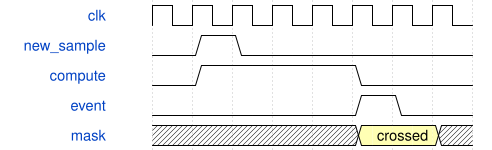

# GuitarEventQueue 模块规范

> RTL: `src/GuitarEventQueue.v`

## 1. 模块目的

未提供模块目的。

## 2. 参数

| 参数 | 默认值 | 说明 |
| --- | --- | --- |
| — | — | 本模块没有可配置参数。 |

## 3. 时钟与复位

- 时钟：`{"name": "i_clk", "frequency_mhz": 50, "edge": "posedge"}`
- 复位：`{"name": "i_rstn", "active": "low", "synchronous": false, "description": "Asynchronous assertion, top synchronizes release"}`

## 4. 接口信号规范

| 信号 | 方向 | 位宽 | 时钟域 | 语义角色 | 描述 |
| --- | --- | --- | --- | --- | --- |
| `i_clk` | input | 1 | 未声明 | clock | i_clk; detailed fields in requirements.md |
| `i_rstn` | input | 1 | 未声明 | reset | i_rstn; detailed fields in requirements.md |
| `i_push` | input | 1 | 未声明 | data | i_push; detailed fields in requirements.md |
| `i_data` | input | 96 | 未声明 | data | i_data; detailed fields in requirements.md |
| `i_pop` | input | 1 | 未声明 | data | i_pop; detailed fields in requirements.md |
| `o_empty` | output | 1 | 未声明 | data | o_empty; detailed fields in requirements.md |
| `o_data` | output | 96 | 未声明 | data | o_data; detailed fields in requirements.md |
| `o_dropped` | output | 16 | 未声明 | data | o_dropped; detailed fields in requirements.md |

## 5. 周期行为与延迟

- 16 entries per board; preserve FIFO order, allow simultaneous full pop/push, saturating16bit overflow count.

## 6. WaveDrom 时序图

### Sample to event

Conceptual pipeline, compressed computation interval, not measured timing.

- WaveJSON：[GuitarEventQueue_crossing.json5](waveforms/GuitarEventQueue_crossing.json5)

## 7. 边界、反压与错误

- Reset clears pending events; invalid samples invalidate contact; simultaneous left/right events preserved.

## 8. CDC 与综合约束

- Single clock domain; bounded finite registers; source protocol in requirements.md

## 9. 验证与验收

- tb_guitar_tracker: centroid, multi-line, reverse, dwell, lift, faults; tb_guitar_queue: full simultaneous operation; tb_touchpad_guitar: pin-level I2C/UART.

## 10. 可追溯性

- 规格模块：`GuitarEventQueue`
- RTL 路径：`src/GuitarEventQueue.v`
- 交付要求：本文档、WaveJSON 和 SVG 必须与同一版本规格一同发布。
