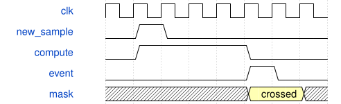

# TouchpadGuitar 模块规范

> RTL: `src/TouchpadGuitar.v`

## 1. 模块目的

未提供模块目的。

## 2. 参数

| 参数 | 默认值 | 说明 |
| --- | --- | --- |
| — | — | 本模块没有可配置参数。 |

## 3. 时钟与复位

- 时钟：`{"name": "i_clk", "frequency_mhz": 50, "edge": "posedge"}`
- 复位：`{"name": "i_rstn", "active": "low", "synchronous": false, "description": "Asynchronous assertion, top synchronizes release"}`

## 4. 接口信号规范

| 信号 | 方向 | 位宽 | 时钟域 | 语义角色 | 描述 |
| --- | --- | --- | --- | --- | --- |
| `i_clk` | input | 1 | 未声明 | clock | i_clk; detailed fields in requirements.md |
| `i_rstn` | input | 1 | 未声明 | reset | i_rstn; detailed fields in requirements.md |
| `i_irq` | input | 2 | 未声明 | data | i_irq; detailed fields in requirements.md |
| `io_scl` | inout | 2 | 未声明 | data | io_scl; detailed fields in requirements.md |
| `io_sda` | inout | 2 | 未声明 | data | io_sda; detailed fields in requirements.md |
| `o_uart_tx` | output | 1 | 未声明 | data | o_uart_tx; detailed fields in requirements.md |

## 5. 周期行为与延迟

- Parallel independent I2C100kHz,50MHz clock, G1 37byte hardware event and compatible T100byte raw frame with CRC8.
- Event queues take priority at UART frame boundary; round-robin among boards; periodic T then G heartbeat.
- 1152008N1,37byte event takes3.22ms; maximum in-flight T blocking8.69ms, excluding queue/back-end transport.

## 6. WaveDrom 时序图

### Sample to event

Conceptual pipeline, compressed computation interval, not measured timing.

- WaveJSON：[TouchpadGuitar_crossing.json5](waveforms/TouchpadGuitar_crossing.json5)

## 7. 边界、反压与错误

- Reset clears pending events; invalid samples invalidate contact; simultaneous left/right events preserved.

## 8. CDC 与综合约束

- Single clock domain; bounded finite registers; source protocol in requirements.md

## 9. 验证与验收

- tb_guitar_tracker: centroid, multi-line, reverse, dwell, lift, faults; tb_guitar_queue: full simultaneous operation; tb_touchpad_guitar: pin-level I2C/UART.

## 10. 可追溯性

- 规格模块：`TouchpadGuitar`
- RTL 路径：`src/TouchpadGuitar.v`
- 交付要求：本文档、WaveJSON 和 SVG 必须与同一版本规格一同发布。
